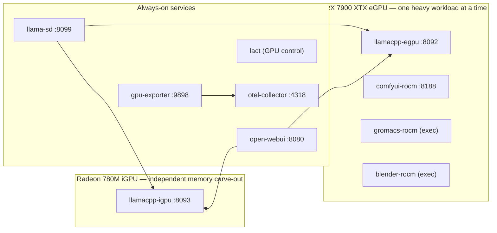

# Spitzenidee's opinionated GenAI stack (for 24 GB VRAM)

This is a (my) containerized stack for local large-language-model inference, image
generation, molecular dynamics, and 3D rendering on a single AMD Radeon RX
7900 XTX eGPU (24 GB GDDR6) paired with a Radeon 780M iGPU. Not at the same time, of course, but one at a time, mediated by `make` targets.

Target host:
- Minisforum UM790 Pro (AMD Ryzen 9 7940HS, 8 cores / 16 threads, Zen 4)
- 64 GB DDR5-5600 system RAM
- AMD Radeon RX 7900 XTX in an OcuLink eGPU dock
- Proxmox VE / Linux VM with VFIO GPU passthrough

The hardware setup is documented in the companion repository
<https://github.com/spitzenidee/um790pro_7900xtx_setup>.

The stack is orchestrated with Docker Compose and a small `make` wrapper.
Because the RX 7900 XTX has no VRAM isolation between compute contexts, only
one GPU-heavy workload runs at a time; switching modes stops the current mode
and starts the target one.

## My "mission statement" and motivation

LLMs and AI in general are tools which are increasingly helpful - and powerful. Once you committed, downsides such as skill atrophy and AI fatigue are bound to set in, making you increasingly reliant, locked-in and dependent on such AI tools. That becomes a real risk if you rent those tools from external providers who...

1. ...own the LLMs, system prompts, SOUL docs etc, and...
2. ...who own the compute, and...
3. ...who own the precision (ie. quantization levels) of LLMs you pay for in the background.

This creates severe vendor lock-in and, in case of a business, strategic dependency. If a provider chooses to cycle LLMs, quant levels etc this may introduce near-undetectable artifacts and service deterioration of processes relying on and modeled after those models. More severe, if a vendor, compute provider or - and we have seen that - state governments decide to pull LLM / AI access for geostrategic reasons (which may, or may not be, justified) and limit access only to hand-selected players, you have an immediate and catastropic service outage and, worst case, loss of revenue while your competitor still enjoys the best SOTA LLM available **to him**. All in all, this may lead to very business-critical life-and-death scenarios (Anthropic Mythos, anyone?).

All in all this culminated in the following realization:

1. I don't own compute, I have to rent it for variable pricing => continuity and budget risk.
2. I don't control the LLM weights, or quantization level => quality / reliability risk.
3. I can't rely on companies, or governments, to ensure service continuity for the previous two points => availability and alignment risk (alignment meaning: I do not control the type of LLM and it's system prompt).

This amounts into a pretty big compound risk. So, with deliberately limited budget I set out to try and control all the above variables to a certain actionable degree:

1. I have compute now in the form of a GPU with 24GB VRAM (plus, in theory, a Mini-PC with 64 GB RAM and an integrated iGPU).
2. I can control and freely choose which LLM to run, and in what quantization, only bound by my hardware limits and software support. I can choose LLMs which have been, to a certain point, community-validated. Plus I fully control the system prompt and harness, if I want to.
3. I do not need to rely on companies for AI services - this is a stretch, because I still rely on sites such as [Huggingface](https://huggingface.co/) to provide repos for huge LLM downloads, and other big players to release their models as open weights in the first place. The time for 100% community-driven open-weight LLMs is not here yet.

I chose a budget limit of 2000€ so "nearly anyone" (yes, I'm aware this is also quite a stretch) could at least try and repeat this or a similar setup. The following prices are partially "old timey" prices, they rose substantially since I bought the first component, a MiniPC, ~2-3 years ago. So, after some research for best ROI I chose this components and went for second-hand where sensible (for deeper details see my [other, more hardware-focused, repo](https://github.com/spitzenidee/um790pro_7900xtx_setup)):

| Component | Price | Year of Purchase | Notes |
|---|---|---|---|
| Minisforum UM790 Pro, 64GB RAM, 1TB SSD | **~800€** | 2023 | |
| Minisforum DEG1 eGPU dock | **~110€** | 2026 | |
| Oculink m.2 adapter | **~20€** | 2026 | |
| AMD Radeon RX 7900 XTX 24GB VRAM | **~650€** | 2026 | bought second-hand locally; chosen simply for the fact that a second-hand NVIDIA RTX 3090 would have cost at least 900€, and both ROCm and Vulkan have matured somewhat in 2025 |
| Power Supply 650W | **~20€** | 2026 | second-hand, bought locally with "*fan makes loud noise, defective*" - changed the fan for a new one, et voilà |
| 2-3 silent fans to help with ventilation | **~50€** | 2026 | |

This gives me a lump sum of my setup of approximately **1650€**, so well within my limit.

### Why GROMACS and BLENDER, then?

Because both benefit vastly from GPU acceleration and I always wanted to test the waters of (algorithmic) 3D rendering and refresh some fun experiments in molecular dynamics simulations, which I worked on during my diploma thesis (see [RuBisCO](https://en.wikipedia.org/wiki/RuBisCO)) and continued for fun during my PhD for a bit.

## Use Cases I wanted to try and establish

- llama.cpp / ollama (I chose llama.cpp for size and flexibility)
  - Optimally running on both the eGPU and the iGPU for flexibility and having to agents with considerable context limits in parallel
  - Integration in HomeAssistant
- OpenWebUI as chat interface, mostly for prototyping and testing
- ComfyUI for e.g. stable diffusion
- Blender for 3D rendering
- Gromacs for Molecular Dynamics Simulation
- Monitoring / observability instrumentation via OpenTelemetry, visualization in a (separate) Grafana instance
- Voltage and power control on the eGPU (lact)
- Push power saving limits, especially in idle, to not waste energy, CO2 and my money.
- Run local coding agents (I chose [pi.dev](https://pi.dev/) for now, because it's lean and easy on context)

## Strategy & manifest

The choices below are the "how" that follows from the mission statement. Together they make the stack one opinionated whole rather than a collection of independent projects.

- **One stack, one entrypoint.** A single `docker-compose.yml` driven by a thin `make` wrapper — not a separate compose file per workload. `make <mode>` stops the current mode's heavy VRAM contenders and starts the target one, leaving every always-on service untouched. I chose this single-switch pattern over externalizing each mode into its own stack compartment because one comprehensible definition of the whole stack is more transparent (to my own brain, that is) than any externalization and modularization of the very definition of the stack. So far it works very reliably.
- **Always-on vs mode services.** Two classes: *always-on* (every mode) — `lact`, `gpu-exporter`, `otel-collector`, `llama-sd`, `llamacpp-igpu` — and *mode-exclusive* (one at a time on the eGPU) — `llama`, `comfyui`, `gromacs`, `blender`. The iGPU service runs on separate hardware (the Radeon 780M) and never contends for eGPU VRAM, so it is always-on. The tables are in [Architecture overview](#architecture-overview) below.
- **GPU access via DRI passthrough.** Containers get the GPUs through bind-mounted DRI render nodes (`/dev/dri/`) and bring their own ROCm/Vulkan user space — no host ROCm install. The VFIO passthrough setup itself is documented in the companion repository linked above.
- **Budget as the guiding constraint.** The whole build is capped at ~2000€ so "nearly anyone" could at least try and repeat it; the per-component prices are in the mission statement above. Second-hand where sensible.

## Architecture overview



All GPU access goes through bind-mounted DRI render nodes (`/dev/dri/`); the
containers bring their own ROCm/Vulkan user space, so no ROCm installation is
required on the host. The VFIO passthrough setup is documented in the companion
repository linked in the introduction.

### GPU work modes

The RX 7900 XTX exposes a single VRAM address space to all ROCm/Vulkan
compute clients. Running two heavy GPU workloads simultaneously (likely) causes OOM
and context-switching stalls, so the stack enforces one active GPU mode at a
time.

| Mode      | Active GPU services                              |
|-----------|--------------------------------------------------|
| `llama`   | `llamacpp-egpu`, `open-webui`                    |
| `comfyui` | `comfyui-rocm`                                   |
| `gromacs` | `gromacs-rocm` (interactive, exec in)            |
| `blender` | `blender-rocm` (interactive, exec in)            |

Always-on services (all modes): `lact`, `gpu-exporter`, `otel-collector`, `llama-sd`, `llamacpp-igpu`.

The iGPU service uses the Radeon 780M — separate hardware with its own
system-memory carve-out — so it does not contend for eGPU VRAM and is
exempt from the mode switch: once started, it keeps running in every mode.
Because that carve-out is simply a reservation from the host's system DRAM,
a model whose weights + KV cache spill past the reserved "VRAM" limit does
not OOM: allocations continue to come from the same physical DDR5 system
memory via GTT. The memory itself is not slower — the iGPU already uses
system DRAM — but performance may degrade due to allocation/mapping
overhead and contention with the CPU/VMM for that memory.

```bash
make            # show help + current status
make llama      # switch to Llama/inference mode
make comfyui    # switch to ComfyUI mode
make gromacs    # switch to GROMACS mode
make blender    # switch to Blender mode
make status     # container state table
```

### Services and ports

| Service          | Port | Mode                | Always on |
|------------------|------|---------------------|-----------|
| `llamacpp-egpu`  | 8092 | `llama`             | no        |
| `llamacpp-igpu`  | 8093 | all                 | yes       |
| `open-webui`     | 8080 | `llama`             | no        |
| `comfyui-rocm`   | 8188 | `comfyui`           | no        |
| `gromacs-rocm`   | —    | `gromacs`           | no        |
| `blender-rocm`   | —    | `blender`           | no        |
| `gpu-exporter`   | 9898 | all                 | yes       |
| `llama-sd`       | 8099 | all                 | yes       |
| `otel-collector` | 4318 | all                 | yes       |
| `lact`           | —    | all                 | yes       |

## The board loop ("Ralph looping")

The stack develops itself through a card/board loop — "Ralph looping". A "dumb"
Python orchestrator (`orchestrator/orchestrator.py`) — **no LLM in the
scheduling loop** — launches phase-specific worker agents **one at a time** on a
[tasks.md](tasks.md/README.md) kanban board: a **refiner** (turns free-form cards
into a canonical spec), an **implementer** (works a card), and a **reviewer**
(reviews the result). The single eGPU model slot means at most one card is in
`Active` at a time, so the orchestrator serializes the workers on that slot.

The human stays in the loop **asynchronously** through the board's lanes and keeps
**full decision power**:

- **Card content** — the human writes and edits cards; the spec is never rewritten by an agent.
- **Sign-off** — `Review → Done` is the human's checkpoint; no card is "done" until the human approves it.
- **Flow** — lane moves and in-lane order (top = highest priority) are the human's to control; the human is the *unblocker* for `AskUser` and `OnHold` cards.

The lanes that carry the asynchronous handover: `Ready` (human → AI), `Active`
(one card at a time), `Review` (AI → human), `Done` (human-approved), plus the
handover lanes `Spec` (human → AI → human), `AskUser` (AI → human → AI) and
`OnHold` (waiting on a condition).

The board protocol (lanes, card format, the `tmd` CLI, user interaction) lives in
[tasks.md/README.md](tasks.md/README.md); the orchestrator (single slot, worker
roles, timers, crash behavior) lives in
[orchestrator/README.md](orchestrator/README.md). The agent-facing hard rules for
this repository are in [`AGENTS.md`](AGENTS.md).

## Component index

| Component | README | What it covers |
|-----------|--------|----------------|
| Inference (llama.cpp) | [llamacpp/README.md](llamacpp/README.md) | eGPU ROCm + iGPU Vulkan builds, models, API, model download |
| Chat frontend (Open WebUI) | [open-webui/README.md](open-webui/README.md) | chat UI + endpoint configuration |
| ComfyUI | [comfyui/README.md](comfyui/README.md) | image generation (ROCm/HIP) work mode |
| Blender | [blender/README.md](blender/README.md) | 3D rendering (Cycles/HIP) work mode |
| GROMACS | [gromacs/README.md](gromacs/README.md) | molecular dynamics (ROCm/HIP) work mode |
| Observability (OpenTelemetry) | [otel/README.md](otel/README.md) | gpu-exporter, llama-sd, otel-collector, host monitor |
| Grafana | [grafana/README.md](grafana/README.md) | dashboards + standalone LGTM backend |
| GPU tuning (LACT) | [lact/README.md](lact/README.md) | voltage / fan / power-cap daemon |
| Task board (tasks.md) | [tasks.md/README.md](tasks.md/README.md) | the board, lanes, card format, `tmd` CLI, user interaction |
| Board orchestrator | [orchestrator/README.md](orchestrator/README.md) | the "dumb" Python loop that drives the board |
| Utility scripts | [scripts/README.md](scripts/README.md) | gpu_monitor, benchmarks, mode switching, wrappers |
| Agent skills | [.pi/README.md](.pi/README.md) | the `.pi/skills/` index (board, GROMACS, vuln-scan, …) |
| Hindsight memory | [hindsight/README.md](hindsight/README.md) | the repository's memory + knowledge base |

## Getting started

### Prerequisites

- Docker Engine with the Compose plugin.
- `make` (thin wrapper around `docker compose`; see the `Makefile`).
- Host `amdgpu` kernel driver with both GPUs visible under `/dev/dri/`
  (VFIO passthrough setup is documented in the companion repo linked above).
- Host group IDs for GPU access (`render`, `video`) — see Configuration.

### Quickstart

```bash
git clone <repo>
cd genai_stack
cp .env.example .env
# edit .env to set APP_ROOT and device paths (see Configuration)

docker compose build
make llama
```

Then:

```bash
# chat endpoint
curl http://localhost:8092/v1/models

# switch workload
make comfyui
```

My recommendation is to start testing this stack either by Gromacs or Blender (one followed by the other) by firing off both the respective smoketests and stresstests. This is a mostly non-interactive check if the compute of both components **really** takes place on the eGPU. You can monitor the eGPU (and iGPU) load in a parallel shell session via the `gpu-monitor.sh` script. In case this keeps hovering around zero, then for sure something is wrong. In both cases it's expected to exceed 90% GPU load after a short time.

For a more interactive test I recommend the `llama` mode to be activated via `make llama`. This will start both `llamacpp-egpu` and `open-webui` (`llamacpp-igpu` is always-on, in all cases). By then using Open-WebUI via a webbrowser and setting up both eGPU and iGPU llama instances as model provider connections you will be able to interactively test both llama instances with the LLM of your choice (and get some numbers on prompt processing and token generation speeds from Open-WebUI).

**Note:** `docker compose build` alone does not refresh the llama.cpp version in
the eGPU image — the ROCm compile lives in the separate
`llama-rocm-builder:latest` image (see [llamacpp/README.md](llamacpp/README.md) → Build). Use the
`rebuild-genai-llama` shell alias to rebuild builder + both llama services in
the correct order:

```bash
alias rebuild-genai-llama="
  cd /home/<my_user>/docker/genai_stack &&
  docker build --no-cache -f llamacpp/Dockerfile.rocm-builder -t llama-rocm-builder:latest llamacpp &&
  docker compose build llamacpp-egpu llamacpp-igpu &&
  docker compose up -d --force-recreate llamacpp-egpu llamacpp-igpu
"
```

### Verifying your setup

| Mode      | Test                       | Command                                                                 | Expected result                        |
|-----------|----------------------------|-------------------------------------------------------------------------|----------------------------------------|
| `llama`   | Inference endpoint         | `curl http://localhost:8092/v1/models`                                  | JSON list of configured models         |
| `comfyui` | Web UI                     | open `http://<host>:8188`                                               | ComfyUI frontend loads                 |
| `gromacs` | Smoketest (water box)      | `docker compose exec gromacs-rocm bash /work/smoketest.sh`              | “Finished mdrun” + GPU-device evidence |
| `gromacs` | Stresstest (MPI-NAT bench) | `docker compose exec gromacs-rocm bash /work/stresstest.sh`             | `ns/day` report after 15 min           |
| `blender` | Smoketest (BMW27)          | `docker compose exec blender-rocm bash /work/_smoketest/smoketest.sh`   | frame 1 in ~11–13 s                    |
| `blender` | Stresstest (Barbershop)    | `docker compose exec blender-rocm bash /work/_stresstest/stresstest.sh` | frame 1 in ~1:40–1:50 min              |

The GROMACS smoketest needs no network; the GROMACS stresstest and both
Blender tests require downloading the assets described in
[gromacs/README.md](gromacs/README.md) and
[blender/README.md](blender/README.md).

## Configuration

Copy `.env.example` to `.env` and fill in:

- `APP_ROOT` — absolute path to this repository.
- `UID` / `GID` — host user/group IDs (default `1000:1000`).
- `*_PORT` variables — host ports for each service.
- `RENDER_GID` / `VIDEO_GID` — host group IDs for GPU access.
- `GPU_RENDER_DEVICE` / `GPU_CARD_DEVICE` — eGPU DRI nodes.
- `GPU_IGPU_RENDER_DEVICE` / `GPU_IGPU_CARD_DEVICE` — iGPU DRI nodes.
- `GROMACS_PROJECTS_DIR` — parent directory for MD projects.

Discover DRI nodes:

```bash
ls -l /sys/class/drm/
```

## Troubleshooting

Stack-level pitfalls. Component-specific entries live in the respective
sub-READMEs (e.g. [llamacpp/README.md](llamacpp/README.md) and
[gromacs/README.md](gromacs/README.md) → Troubleshooting).

- **IOMMU TLB-flush storms (VFIO/KVM passthrough).** All ROCm services set
  `HSA_ENABLE_SDMA=0`; without it, SDMA usage triggers severe TLB-flush
  stalls.
- **Container cannot see the GPU.** Check the DRI nodes (`ls -l
  /sys/class/drm/`) and that `RENDER_GID`/`VIDEO_GID` in `.env` match the
  group owners of the render nodes.
- **VRAM OOM or context-switch stalls.** Two heavy GPU workloads are
  competing for the eGPU — switch to a single mode with `make <mode>`
  instead of starting services manually.

## Disclaimer

> **This stack, and therefore also this README, have been conceived, implemented and written with significant usage of LLMs (e.g. Github CoPilot).**

> In parts, you can expect the percentage to be 90% implementation by AI, with 90% steering and specification done by a human (me). In other parts, this may change to 100% implementation by AI and only 50% steering by me, because during spec and finetuning with AI I let it loose when I suspected it's intended direction fit my own needs and hardware (e.g. OTel instrumentation via the `llama-sd` component, or `lact`). I let AI write the scaffolding of the README and other docs based on hard factual knowledge extracted from the codebase, let it integrate todos and pointers for me to fill in with my own intentions, information, goals etc, and the result is the README you are currently reading. It's a mixture of purely human-written parts, mixed together with parts written 80-100% by AI.

> Also, this stack and repo are in a state of slow, yet steady, flow - it cannot be considered stable, easy to setup and following a strict release cycle yet (and probably for all eternity). This repo is deliberately experimental and supports my own hardware and use cases as optimal as possible. It is not something that applies on a generalistic scale.

## Maintainer note

Public snapshot via the publish pipeline (`docs/publishing.md`, private to this repo).
